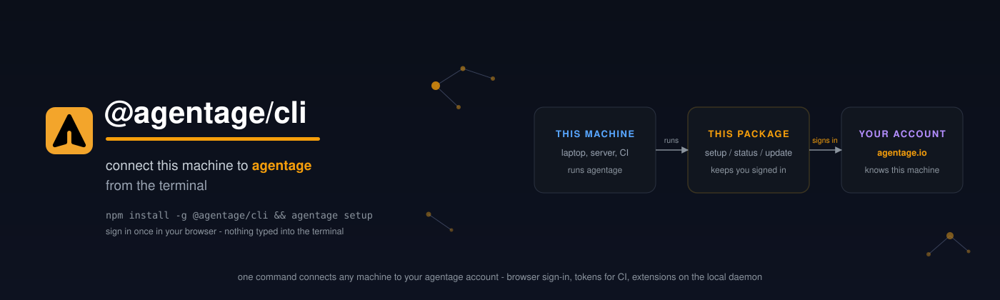
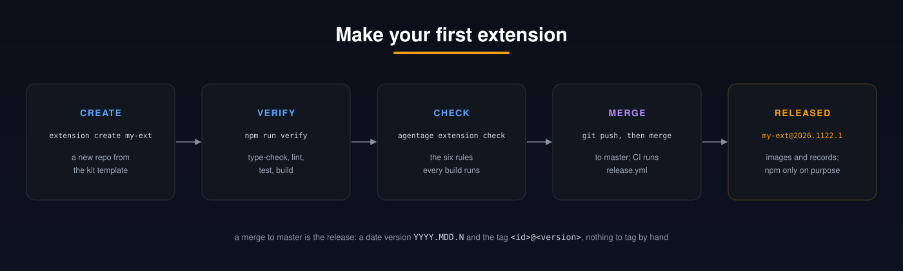

# @agentage/cli



The `agentage` command connects each machine you use to your agentage account and runs
extensions on it. It is also the tool to make and release your own extension. Use it from a
terminal, a server or CI. You need Node.js 22 or newer.

```bash
npm i -g @agentage/cli
agentage setup    # sign in in your browser, then start the local daemon
```

Status: before 1.0. Extensions run on the local daemon (`127.0.0.1:4243`) of each machine.

## Commands

Each command has `--help`. The full reference is [docs/reference.md](docs/reference.md).

| Command                        | What it does                                                             |
| ------------------------------ | ------------------------------------------------------------------------ |
| `agentage setup`               | Sign in and connect this machine to your account; start the daemon       |
| `agentage status`              | Show the cli, account, endpoint, machine, profile and extension status   |
| `agentage update`              | Update `@agentage/cli` to the latest published version                   |
| `agentage daemon`              | Start, show, stop or restart the local daemon that runs extensions       |
| `extension install <name>`     | Install an extension (`<id>`, `<id>@<version>` or a folder) and run it   |
| `extension list`               | Show each installed extension: id, version, source, state                |
| `extension update [id]`        | Move each market extension, or one, to its newest version                |
| `extension disable <id>`       | Stop an extension, keep its data                                         |
| `extension enable <id>`        | Run a disabled extension again                                           |
| `extension configure <id> k=v` | Set settings (or `--secret` secrets) of an extension, no restart         |
| `extension remove <id>`        | Stop and remove an extension; its data stays unless `--purge`            |
| `extension doctor`             | Load every extension once and refresh its state: ok or failed            |
| `extension create <id>`        | Create `./extension-<id>` from the extension template                    |
| `extension check [dir]`        | Check that an extension package conforms, as every build does first      |
| `extension build`              | Build the extension package; `--container` builds one image of all parts |
| `extension release`            | Release an extension in CI; `--changed` releases each changed extension  |
| `extension up`                 | Run the working copy on the daemon and reload each change                |
| `extension down`               | Stop what `extension up` started here                                    |
| `extension token`              | Print a token from the dev issuer that `extension up --docker` started   |

`extension ...` means `agentage extension ...`. Add `--json` to most commands for one JSON object
on stdout: `{ success, data }` or `{ success: false, error }`. On a server with no browser, use a
personal access token: `AGENTAGE_TOKEN=aga_... agentage status`.

## Make your first extension



You need git and network. Run these in an empty folder:

```bash
agentage extension create my-ext
cd extension-my-ext
npm ci
npm run verify
npx agentage extension check    # PASS my-ext 0.1.2 conforms (6 rules)
git init -b master && git add -A && git commit -m "feat: my-ext extension"
```

`create` copies the template from `agentage/kit:template` and writes your id into every file. In
the folder, use `npx agentage`: it runs the cli version that the folder pins. The guide of the new
folder is its own `README.md`. `check` may end with an `update available` line when the cli that
runs it is older than the newest on npm.

`create` builds the folder and gives it to the local daemon, so it runs at once. Add `--no-install`
to only create the files: CI and agents always do. Two more commands change the local daemon:
`npx agentage extension up` runs the folder there and reloads each change, and
`agentage extension install ./extension-my-ext` installs it there.

## How an extension is released

Push the repo to GitHub. A release runs in CI in one of two modes:

- A repo with one or several extensions: each merge to master runs `agentage extension release --changed`. This is what a new repo from `create` does.
- A repo with one extension can instead release by a pushed tag `v<version>`: `agentage extension release`.

With `--changed`, a changed extension gets a date version
`YYYY.MDD.N` (for example `2026.1122.1`), the tag `<id>@<version>`, its images and its records on
the GitHub release. A change only in a root `*.md` file, `docs/` or `.github/` releases nothing.
A `.release-ignore` file adds more patterns. The new package is private: it goes to npm only when
you remove `"private": true`. The rule in full: [docs/reference.md](docs/reference.md#extension-release).

## How to work on this repo

```bash
npm ci
npm run verify                                         # type-check, lint, format, test, build
npm run build && npm run test:e2e -- --grep @offline   # e2e with a loopback npm registry
```

## How a change is released

A merge of a normal change releases nothing. The `chore(release): X.Y.Z` PR from
`prepare-release.yml` changes `package.json`; its merge runs `release.yml`, which publishes to npm
with OIDC trusted publishing and pushes the tag `vX.Y.Z`. Details: [docs/release.md](docs/release.md).

## For agents

- Read [AGENTS.md](AGENTS.md) (the same file as `CLAUDE.md`): commands, layout and where each fact lives.
- Never run `setup`, `update`, `extension up` or `extension install` on a shared machine, and always add `--no-install` to `extension create`.
- Never publish to npm by hand: only `release.yml` publishes.

## Links

- [docs/reference.md](docs/reference.md): every flag, exit code, environment variable and file.
- [docs/extensions.md](docs/extensions.md): write, check and run your own extension.
- [docs/profiles.md](docs/profiles.md): profiles, extension states, the plan and updates.
- [agentage/kit](https://github.com/agentage/kit): the kit and the extension template.
- [agentage/examples](https://github.com/agentage/examples): the probe and fixture extensions.

## License

MIT. See [LICENSE](LICENSE).
