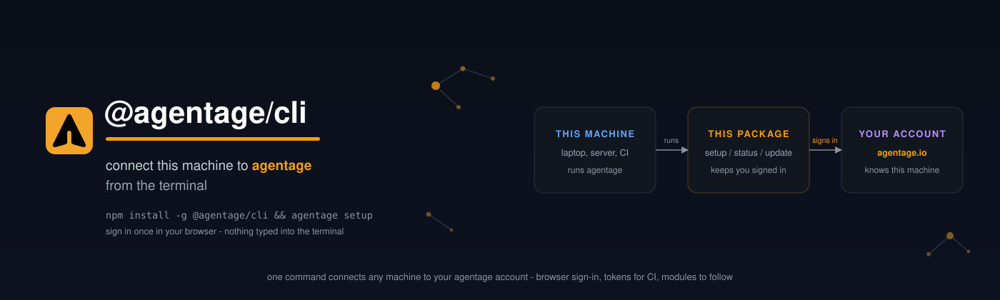

# @agentage/cli



```bash
npm install -g @agentage/cli && agentage setup
```

## What is this?

agentage gives your AI tools a shared place that belongs to your account. This package connects
each machine you use to that account. It keeps your sign-in on the machine (OAuth 2.1 with PKCE,
nothing typed into the terminal), tells you whether the machine is connected, and keeps itself
up to date.

The CLI stays **small**: sign-in, status, update, and an extension manager. Everything else,
memory included, arrives as an extension the CLI installs for you.

## Get started

Needs Node.js 22 or newer. Install, list, run and remove need nothing else. For your own
extensions, `create` needs git and network. `build` and `up` need Docker and git, and `release` also
needs the `gh` CLI (see [Write and run your own extension](#write-and-run-your-own-extension)).

```bash
npm install -g @agentage/cli
agentage setup
```

`setup` opens your browser, you sign in, and the session is stored in `~/.agentage`. Check it
with `agentage status`.

You can skip `setup` if you only want extensions: installing, listing, running and removing them
needs no sign-in, so `agentage extension install probe` works without one. Sign-in adds your
account's profile and the same extensions on every machine.

### On a server or in CI (no browser)

```bash
agentage setup --no-browser              # prints the sign-in URL instead of opening a browser
AGENTAGE_TOKEN=aga_... agentage status   # or use a personal access token
```

## Commands

| Command                       | What it does                                                                  |
| ----------------------------- | ----------------------------------------------------------------------------- |
| `agentage setup`              | Sign in through your browser, install your account's profile, show status     |
| `agentage setup --no-browser` | Print the sign-in URL instead of opening a browser                            |
| `agentage setup --reauth`     | Force a fresh sign-in                                                         |
| `agentage setup --disconnect` | Sign out and remove local credentials                                         |
| `agentage status`             | Version, update, target, sign-in, endpoint, then machine, profile, extensions |
| `agentage update`             | Install the latest published version (`--check` only reports)                 |

For extensions (see below):

| Command                                      | What it does                                                     |
| -------------------------------------------- | ---------------------------------------------------------------- |
| `agentage setup --profile <file>`            | Install and load the extensions a profile file names, no sign-in |
| `agentage setup --profile <file> --dry-run`  | Show what would be installed, write nothing                      |
| `agentage setup --latest`                    | Update each extension to the newest version its range allows     |
| `agentage extension install <name> [--off]`  | Add an extension to the profile, install and load it             |
| `agentage extension remove <name> [--purge]` | Take it out of the profile and reinstall the rest                |
| `agentage extension list`                    | One row per extension: state, version, commands, last run        |
| `agentage extension doctor`                  | Load every extension once and refresh the states                 |
| `agentage <command>`                         | Run a command an installed extension contributes                 |
| `agentage <id> <command>`                    | The same for an extension built on the kit; always works         |

Flags, exit codes and token auth are in [`docs/reference.md`](docs/reference.md).

## Extensions

An extension is an npm package that adds commands to the CLI. Extensions are on by default. A
machine whose profile names no extensions has none.

- A **profile** says what your account wants: which extensions, at which version ranges, and which
  ones are switched off on which machine.
- The CLI brings the machine to that state. `setup` installs what the profile names, loads each
  extension once and prints whether it loaded (`ok`) or why not.
- `extension install` and `extension remove` edit the profile and then do the same.
- Nothing installs itself on a timer. The state changes only when you run a command.

Extensions run in the CLI process with your privileges, so install only extensions you trust.
npm runs with `--ignore-scripts`. The account token is removed from the environment before any
extension code loads.

### Write and run your own extension

## Where things live

Everything the CLI keeps is in the config directory, `~/.agentage` by default:

| Path                        | What                                                                                           |
| --------------------------- | ---------------------------------------------------------------------------------------------- |
| `~/.agentage/auth.json`     | your sign-in, owner-only                                                                       |
| `~/.agentage/profile.json`  | the profile: what this account wants                                                           |
| `~/.agentage/machine.json`  | this machine's id, name, development extensions and account                                    |
| `~/.agentage/extensions/`   | installed extensions: `package.json`, the lock, `trees/<hash>/`; `current` names the live tree |
| `~/.agentage/state/`        | the last run of each extension                                                                 |
| `~/.agentage/commands.json` | which extension holds each top-level command                                                   |
| `~/.agentage/secrets.json`  | extension secrets, owner-only                                                                  |
| `~/.agentage/data/<id>/`    | what each extension keeps                                                                      |

`status` writes `machine.json` even before you sign in.

To uninstall: run `agentage setup --disconnect`, then `npm uninstall -g @agentage/cli`. The
uninstall leaves `~/.agentage`. Delete that folder to remove everything.

Every flag is in [`docs/reference.md`](docs/reference.md).
To write an extension, start with [`docs/extensions.md`](docs/extensions.md).

## How it works

This is the **terminal client for an agentage account**. `setup` registers a one-off OAuth
client, opens the authorization page in your browser and waits on a localhost callback; the
tokens land in `~/.agentage/auth.json` with owner-only permissions and are refreshed
automatically. `status` validates the session against the account's introspection endpoint
and reports version, update, target host and connectivity. Nothing runs in the background, and
nothing is installed beyond this package unless your profile names extensions.

## Configuration

| Env                       | Default               | Purpose                                                              |
| ------------------------- | --------------------- | -------------------------------------------------------------------- |
| `AGENTAGE_SITE_FQDN`      | `agentage.io`         | Target host                                                          |
| `AGENTAGE_CONFIG_DIR`     | `~/.agentage`         | Config and credentials directory                                     |
| `AGENTAGE_TOKEN`          | -                     | Personal access token for CI and headless machines                   |
| `AGENTAGE_EXTENSIONS_DIR` | `<config>/extensions` | Where extensions are installed (`<config>` is `AGENTAGE_CONFIG_DIR`) |
| `NO_COLOR`                | -                     | Disable colored output                                               |

## Develop

```bash
npm ci
npm run verify
npm run build && npm run test:e2e -- --grep @offline
```

The e2e specs under `e2e/core/` read as scenarios: each title names the command and what must
hold. They run against a loopback registry that serves the extensions under `fixtures/`.

## Release

Releases publish to npm via GitHub Actions when a `chore(release): X.Y.Z` commit that touches
`package.json` lands on `master` (the squash-merge subject of a release PR). The workflow skips
any version already on npm.

`agentage extension release` skips npm for a package with `"private": true`. It pushes the images, attaches the record and prints `PASS npm: private package, not published`.

## License

MIT - see [LICENSE](./LICENSE).
